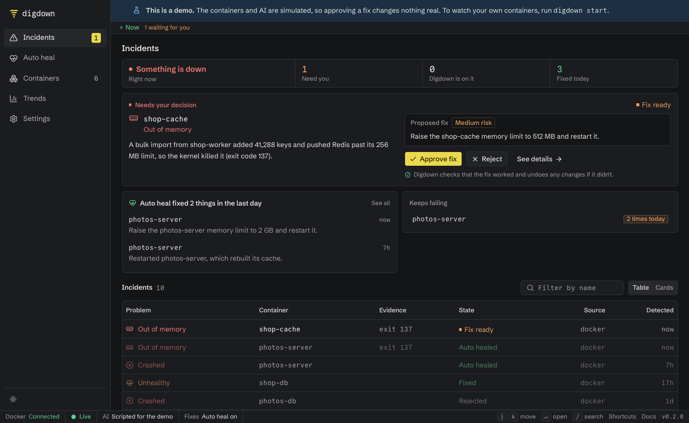

# Digdown

Digdown keeps track of the apps you run in Docker. When a container fails, it works out why, explains it in plain language, and can fix the cause. It checks that the fix held and undoes it if it didn't.

It's for people who self-host apps they didn't write and can't debug from the inside. A restart policy brings a crashed container back. Digdown tells you why it crashed, and when a container keeps running out of memory, it raises the limit instead of restarting it forever.

It's self-hosted, sends no telemetry, and can run entirely on your own computer with a local AI model.

**It works with any app you run in Docker,** with no plugin or setup for each app. Turn on auto heal for an app and it fixes whatever needs no decision from you: crashes, restart loops, running out of memory, failed health checks, or a database an app depends on. A wrong setting, a missing secret or a bug in the app needs you, so Digdown explains the cause and what to change. [See exactly what it fixes](docs/auto-heal.md).



**This is a beta.** It has been tested end to end with real containers, including the Docker install, on one Mac using Docker Desktop and a local model. Hosted AI services, Linux, Coolify, and alerts through real Discord, Slack and ntfy accounts haven't been tested yet. [See what has and hasn't been tried](docs/whats-been-tested.md). It can restart your containers and needs full access to Docker, so start with **Explain only**, and try it somewhere that isn't production first.

## Try it in a minute

The demo needs no Docker and no AI model. The containers and the AI are simulated, so nothing on your computer changes.

```bash
git clone https://github.com/aishwaryawambule/digdown.git && cd digdown
python3 -m venv .venv && . .venv/bin/activate   # needs Python 3.11 or newer
scripts/build-dashboard.sh                      # needs Node 22 or newer
pip install .
digdown demo
```

[What to look for in the demo](docs/try-the-demo.md).

## Use it on your containers

You'll need Docker. Run this where your apps run:

```bash
docker run -d --name digdown --restart unless-stopped \
  -p 127.0.0.1:8088:8088 \
  -v /var/run/docker.sock:/var/run/docker.sock -v digdown-data:/data \
  --add-host host.docker.internal:host-gateway \
  ghcr.io/aishwaryawambule/digdown:latest
docker logs digdown     # prints a link that signs you in
```

Open the link. Setup asks three questions: what to watch, which AI to use, and what Digdown may do. [Step-by-step install](docs/install-with-docker.md), including Compose and building it yourself.

## What Digdown may do

You choose this during setup, and can change it any time in Settings.

| Setting | What Digdown does | Changes anything? |
|---|---|---|
| **Explain only** (default) | Shows what broke and why | Never |
| **Suggest fixes** | Also suggests a fix for you to carry out | Never |
| **Fix after I approve** | Applies a fix when you click Approve, checks it, and undoes any changes if it doesn't hold | Only after your click |
| **Fix things by itself** | Turns on auto heal for every app: runs any fix that needs no decision from you, without waiting. You can also turn it on app by app. | Yes, within [strict limits](docs/auto-heal.md) |

The AI can only read. A separate component makes the changes, and only from a short list. It can't fix everything: a wrong setting or a bug in an app needs a person, so Digdown explains the cause and asks.

## How good is the AI?

On simple test failures with known causes, `qwen3:14b` on a 24 GB Mac found the right cause in 12 of 12 runs, at about 2 to 5 minutes each. A stopped dependency needs no AI and is fixed in about 20 seconds. The AI doesn't reliably say when it can't tell why, so read a confident cause as a best guess. That's a small test, and results on real stacks were less consistent. [See the details](docs/whats-been-tested.md#how-accurate-is-the-ai).

## Documentation

| Start here | Using it | Reference |
|---|---|---|
| [What is Digdown?](docs/index.md) | [The dashboard](docs/using-the-dashboard.md) | [What's been tested](docs/whats-been-tested.md) |
| [Try the demo](docs/try-the-demo.md) | [Handle an incident](docs/handle-an-incident.md) | [Questions](docs/faq.md) |
| [Install with Docker](docs/install-with-docker.md) | [Auto heal](docs/auto-heal.md) | [Commands and shortcuts](docs/commands.md) |
| [Install without Docker](docs/install-directly.md) | [Choose which apps to watch](docs/choose-apps.md) | [Settings file](docs/configuration.md) |
| [First-time setup](docs/first-time-setup.md) | [Set up alerts](docs/alerts.md) | [Security](docs/security.md) |
| [Choose an AI](docs/choose-an-ai.md) | [Run on a server](docs/run-on-a-server.md) | [How it works](docs/how-it-works.md) |
| [Practise with a broken stack](docs/practice-with-the-sandbox.md) | [Watch another server](docs/watch-another-server.md) | [Troubleshooting](docs/troubleshooting.md) |
| | [Update, back up, or remove](docs/update-and-uninstall.md) | [Changelog](CHANGELOG.md) |

## Security

Docker socket access amounts to root on that computer, so treat Digdown accordingly. The Docker install asks for a token, the AI can't change anything directly, and secrets are masked before anything goes to the AI. Personal data in logs isn't masked, so use a local model if your logs hold any. [Read more](docs/security.md).

## Developing

```bash
python3 -m venv .venv && . .venv/bin/activate
pip install -e ".[dev]"
pytest

cd web && npm ci && npm test
npm run dev    # http://localhost:5173, forwarding /api to Digdown on :8088
```

Add `?mock` to the dashboard's address to see it with sample data and no backend. The website and docs site build from `docs/`: `cd website && npm ci && npm run dev`.

## Contributing

See [CONTRIBUTING.md](CONTRIBUTING.md). To report a security problem, see [Security](docs/security.md#reporting-a-problem).

## License

[Apache-2.0](LICENSE)

The first version of the dashboard was built with [Design Lounge](https://www.designlounge.live), which inspired the design it has today.
