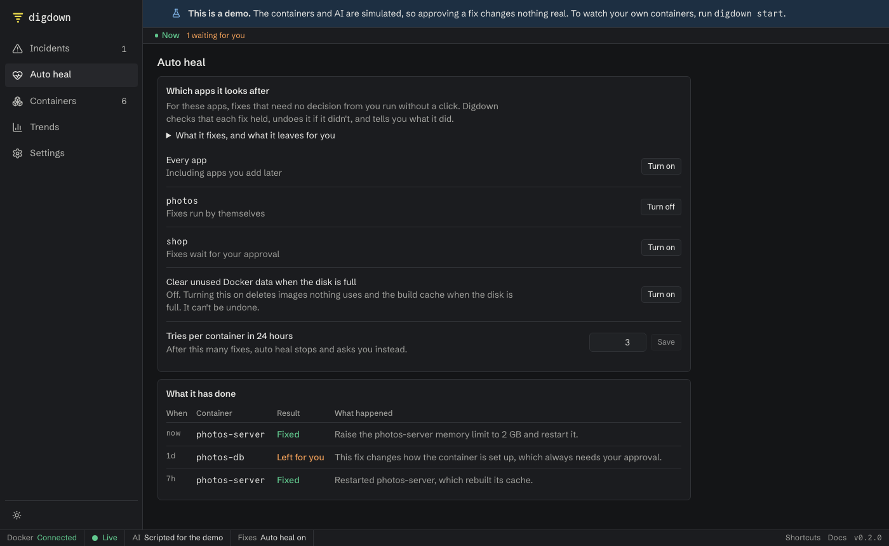

Auto heal fixes failures that need no decision from you, without waiting, then tells you what it did. It's off until you turn it on for an app.

## Turn it on

**During setup:** choose **Fix things by itself**. That turns it on for every app.

**Later:**

1. **Open Auto heal** in the menu.
2. **Click Turn on** beside **Every app**, or beside one app, then confirm. If fixes weren't allowed yet, this allows them too.

**You should see** the app change to `Fixes run by themselves`. The app also shows an **Auto heal on** badge on the Containers page.

**Every app** includes apps you start later. Turning it off leaves on any apps you turned on one by one.

Auto heal needs an AI connected, even for the fixes that don't use it. Start with one app where a needless restart would be harmless. **The AI can get a cause wrong,** and nobody checks it before the fix runs.

## Which apps it works with

Any app you run in Docker: a photo library, a wiki, a database, or something you built. Digdown works from what Docker reports, so there's no plugin or setup for each app. It doesn't matter whether you started it with Compose, Coolify or a plain `docker run`.

## What it fixes by itself

The rule is simple: if a fix doesn't need your knowledge or judgement, auto heal does it.

| What went wrong | What auto heal does |
|---|---|
| Crashed, or stuck restarting | Restarts it, or starts the database or other service it depends on |
| Ran out of memory | Raises its memory limit, by up to double, and restarts it |
| Failing its health check | Restarts it |
| Stopped by itself, when an app depends on it or it's set to keep running | Starts it |
| Stuck without ever starting | Starts it |
| Close to its memory limit | Raises the limit, with no restart |
| Returning errors, responding slowly, or logging lots of errors, if you've added a [website check](using-the-dashboard.md#settings) or a [log check](configuration.md#website-and-log-checks) | Restarts it, then runs the same check again |
| The disk is full, if you've turned this on | Clears unused Docker data (see below) |

Then it checks that the fix held, and undoes it if it didn't.

When an app is failing because something it depends on stopped cleanly, or a container never started, Digdown doesn't need the AI: Docker reports the facts, so it's fixed in about 20 seconds. If that container had been down for over an hour, the record says so, for example "Start photos-db, which had been down for 9 days", so you can spot it if you'd stopped it on purpose.

## What still needs you

These aren't limits auto heal could grow out of. Each one needs something only you know.

- **A wrong setting, a missing secret, a bug in the app, or a port already in use.** Restarting can't fix these. Digdown explains the cause and what to change.
- **Something you stopped or paused.** That was your choice, so Digdown leaves it alone. Docker's event log only goes back about a day, so an older stop can't be seen. If a failing app needs a container you stopped longer ago than that, Digdown will start it. Turn auto heal off for that app if that's not what you want.
- **A container that was already down when Digdown noticed,** unless an app that's failing depends on it.
- **A container that exited cleanly with no restart policy,** unless an app that's failing depends on it. It may be a job that finished, such as a migration or a backup, and running it again could do harm.
- **A fix that changes how a container is set up.** Recreating one can lose anything stored inside it, and changing a setting needs your judgement. So does more than doubling a memory limit.

## When it stops and asks

These rules are plain code, so the AI can't talk its way past them:

- The AI isn't confident of the cause, or the second AI check disagrees
- The same problem came back after an earlier fix
- It has already tried 3 times on that container in 24 hours (you can change this)
- It has made 5 fixes in the last hour, which points to a bigger problem on the machine
- An alert came from outside Digdown, so it couldn't confirm a fix afterwards

## Clear unused Docker data when the disk is full

This has its own switch on the **Auto heal** page, and it's off until you turn it on and confirm, because deleting can't be undone. **If the disk is already full, it runs straight away.**

When the disk is full, it deletes images that nothing uses and Docker's build cache, at most once a day. **It never deletes containers or volumes.** The AI doesn't choose this: a fixed rule runs it. If the disk is still full afterwards, Digdown says so and leaves it for you.

On Docker Desktop for Mac or Windows, this may not free space on your computer, because Docker keeps its data in a virtual disk that doesn't always shrink.

## See what it did

The **Auto heal** page lists everything it has fixed, undone or left for you, with the reason. Click a row to open that incident.

To get a message when it acts, [set up alerts](alerts.md).

## Containers not in a Compose app

Containers started with a plain `docker run` are grouped as **Containers not in a Compose app**, and can be turned on together.

## Turn it off

Click **Turn off** beside the app, or beside **Every app**. If you change **Settings → Fixes** away from **Fix after I approve**, auto heal pauses for every app, and the Auto heal page offers **Resume**.
