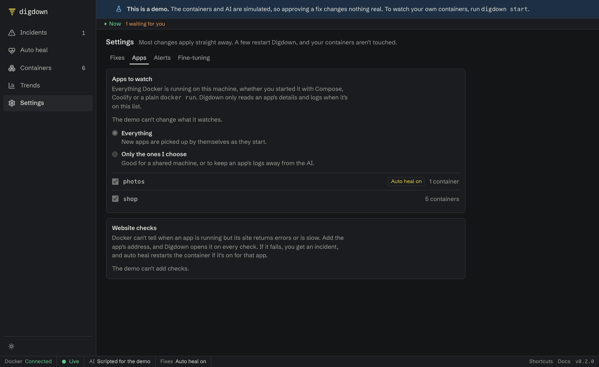

Digdown only reads an app's details and logs if it's on your list. It works with anything Docker runs, whether you started it with Compose or a plain `docker run`. Apps deployed by other tools, such as Coolify, should work the same way, but [that hasn't been tested yet](whats-been-tested.md).

Your apps don't move anywhere, and Digdown doesn't need their Compose files. It reads what it needs from Docker.

## Steps

1. Go to **Settings → Apps**. You'll see everything Docker is running on this machine.
2. Choose one:
   - **Everything.** New apps are picked up by themselves as they start.
   - **Only the ones I choose.** Then tick the apps you want.
3. Click **Save and restart**. Digdown restarts in a few seconds, and your containers aren't touched.

**You should see** your choices still in place after the page reloads, and the chosen apps on the **Containers** page.

## Stop incidents for one app, but keep watching

To quiet something noisy, use **Mute** on the Containers page. It stops incidents and diagnoses for that container or app, and you can undo it there. Muting doesn't touch the container.
