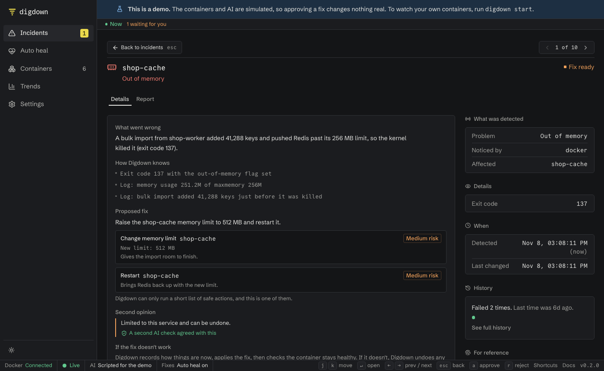

An incident is one thing that went wrong. Here's how to deal with one.

## 1. Open it

Click an incident on the **Incidents** page, or press `j` and `k` to move and `Enter` to open.

## 2. Read what went wrong

The **Details** tab shows:

- **What went wrong:** the cause, in plain language.
- **How Digdown knows:** the evidence, such as log lines and exit codes.
- **Second opinion:** what the second AI check thought. If it says it disagreed, treat the diagnosis as a best guess.
- **Proposed fix,** and how risky it is, if a safe fix exists.

## 3. Decide

What you can do depends on the setting under **Settings → Fixes**.

**If you see Approve fix and Reject:**

- **Approve fix** applies it. Digdown saves the current state, makes the change, then checks for about a minute that the container stays healthy.
- **Reject** closes the incident and changes nothing.

**If it says to do something yourself,** Digdown can't safely fix this one, usually a wrong setting, a missing secret, or a bug. Follow the instructions, and the incident closes by itself once the container has been healthy for about a minute.

## 4. See how it ended

| It says | What it means |
|---|---|
| **Fixed and confirmed healthy** | The fix worked and the container stayed up |
| **Fixed automatically and confirmed healthy** | Auto heal did this without a click |
| **The fix didn't work, so it was undone** | Any changed settings were restored. It needs you now. |
| **The fix couldn't be applied** | Something went wrong partway. Check the container. |
| **Cleared without a fix** | The problem went away by itself |
| **Closed with no automatic fix** | Digdown had no safe fix, or wasn't confident in the cause |

## If a raised memory limit should stick

Digdown raises a limit on the running container. **Recreating the container, as an update does, loses it.** Digdown shows the line to add to your Compose file, such as `mem_limit: 512m`, so add it to keep the new limit.

## Share what happened

The **Report** tab is a write-up you can copy or download as Markdown.

## Something Digdown keeps getting wrong?

- **Retry diagnosis** runs it again if it failed.
- **Mute** on the Containers page stops incidents for a container or app, without touching it.
