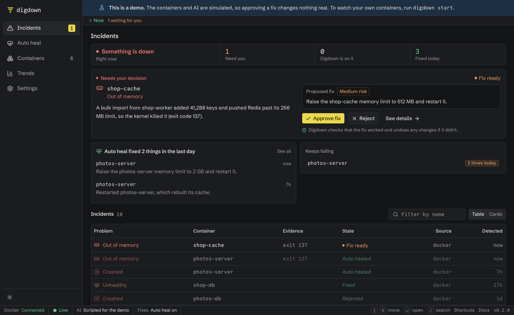

Digdown keeps track of the apps you run in Docker. When a container fails, it works out why and explains it in plain language. If you allow it, it can also fix the cause, check that the fix held, and undo the fix if it didn't.

It's for people who self-host apps they didn't write, such as a photo library, a wiki or a password manager, and who can't debug them from the inside.

## What happens when something fails

1. **It notices.** Digdown checks your containers every 15 seconds for crashes, running out of memory, crash loops, failed health checks, and a disk that's nearly full.
2. **It looks into it.** An AI model reads the container's logs and state and works out the cause.
3. **A second AI check reviews the answer.** If the evidence contradicts the diagnosis, it's rejected, so you don't get a confident wrong answer.
4. **It tells you what to do.** You get the cause in plain language, with a proposed fix if a safe one exists.
5. **It can fix it.** Depending on what you allow, it waits for your approval or fixes by itself whatever needs no decision from you. Either way, it checks that the fix held and undoes changes if it didn't.

## How much it does is up to you

| Setting | What Digdown does | Changes anything? |
|---|---|---|
| **Explain only** (the default) | Shows what broke and why | Never |
| **Suggest fixes** | Also suggests a fix for you to carry out | Never |
| **Fix after I approve** | Applies a fix when you click Approve | Only after your click |
| **Auto heal**, app by app | Runs any fix that needs no decision from you, without waiting | Yes, within [strict limits](auto-heal.md) |

## What you'll need

- **Docker**, running on the computer or server you want to watch.
- **An AI model**, if you want to know why things failed. It can run on your own computer with [Ollama](choose-an-ai.md), or you can use a hosted service. Without one, Digdown still tells you what failed and when.

## What it isn't

- **Not for Kubernetes.** It's built for Docker and Docker Compose.
- **Not a replacement for backups or monitoring.** It looks at containers, not at your data.
- **Not able to fix everything.** A wrong setting or a bug in an app needs a person. Digdown tells you the cause and asks.
- **Not finished.** It's a beta. See [what's been tested](whats-been-tested.md).

## Where to go next

- **See it working in a minute,** with nothing real involved: [try the demo](try-the-demo.md).
- **Use it on your own containers:** [install with Docker](install-with-docker.md).
