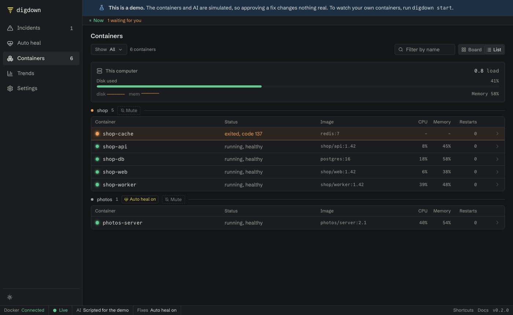

The dashboard comes with Digdown at <http://localhost:8088>. Updates arrive live. It starts in dark mode, with a switch to light.

On a phone, the sidebar moves into a menu.

See [first-time setup](first-time-setup.md) for what happens the first time you open it.

## Layout

The dashboard is dark by default, and the moon or sun icon in the sidebar switches it. The bar along the bottom always shows whether Docker is connected, which AI is in use, and how far Digdown may go.

## Sign in

The Docker install, and any copy reachable from other machines, asks for a token first. Digdown prints a sign-in link when it starts: see it with `docker logs digdown`, or `docker compose logs digdown` with Compose. See [security](security.md).

## Banners

These appear above the page whenever the page can't be fully trusted:

- **Nothing is being watched.** Digdown can't reach Docker, so it can't tell whether anything is failing. It reconnects by itself.
- **AI diagnosis is off.** You'll see what failed but not why.
- **Lost connection to Digdown.** The page may be out of date until it reconnects.
- **This is a demo.** Nothing here is real.

## Incidents

The main screen answers "does anything need me?"

- **The strip along the top** says whether anything is down, then counts what needs you, what Digdown is working on, and what was fixed today. Click a figure to see what it counts. The Containers page shows which containers have problems.
- **The main card** shows the most urgent incident. Click anywhere on it to open it. It shows what went wrong, the proposed fix, and buttons to approve or reject it. When nothing is wrong, it says so, but only if Digdown can actually see your containers.
- **Auto heal fixed…** lists what it fixed by itself in the last day, when there's anything to list. If auto heal left an incident for you, the main card says why.
- **Keeps failing** lists containers with repeated failures.
- **The list** groups incidents into **Needs you**, **In progress** and **Finished**. An incident closes by itself about a minute after the problem goes away, shown as **Cleared**. Choose **Table** or **Cards**, and filter by name or source.

## An incident

**Details** shows what went wrong, how Digdown knows, the proposed fix and its risk, what a second AI check thought, what happens if the fix doesn't work, and the steps the AI took. If Digdown can't safely fix the problem, it tells you what to do instead.

**Report** is a write-up you can copy or download as Markdown.

## Containers

Everything Digdown is watching, grouped by app, with status, CPU, memory and restarts. Choose **List** or **Board**. The **HTTP** tab shows any addresses you've set up as probes. Select a container to see its details and past incidents.

**Mute** tells Digdown to stop raising incidents for a container or stack. It doesn't touch the containers.

## Trends

What has failed over the last 24 hours, 7 days or 30 days: how many incidents, how long fixes took, how often they worked, and which containers fail most.

## Auto heal

Turn auto heal on or off for every app at once, or one app at a time. Below that, it lists everything auto heal has fixed, undone or left for you, with the reason.

## Settings

Most changes apply straight away. A few restart Digdown, and your containers aren't touched.

- **Fixes:** what Digdown may do when something fails.
- **Apps:** everything Docker is running on this machine, and which of it to watch. **Website checks** let Digdown open an app's address on every check, to catch an app that's running but returning errors or slow.
- **Alerts:** where messages go. Paste an address and click **Send test** to check it.
- **AI:** change your AI model.
- **Fine-tuning:** how it notices problems, its AI checks, and how long it checks a fix. Change what you like, then click **Save changes** once. **Advanced settings** covers settings read at startup. Network, passwords and file locations can only be changed in the settings file, for safety.

## Links

Every page has its own address, so refresh and the Back button work, and you can bookmark a page or share a link to an incident, such as `#/incidents/42` or `#/settings/alerts`.

## Keyboard shortcuts

Press `?` in the dashboard, or see [commands and shortcuts](commands.md).
